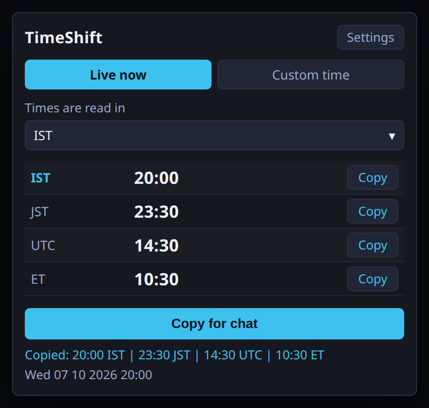
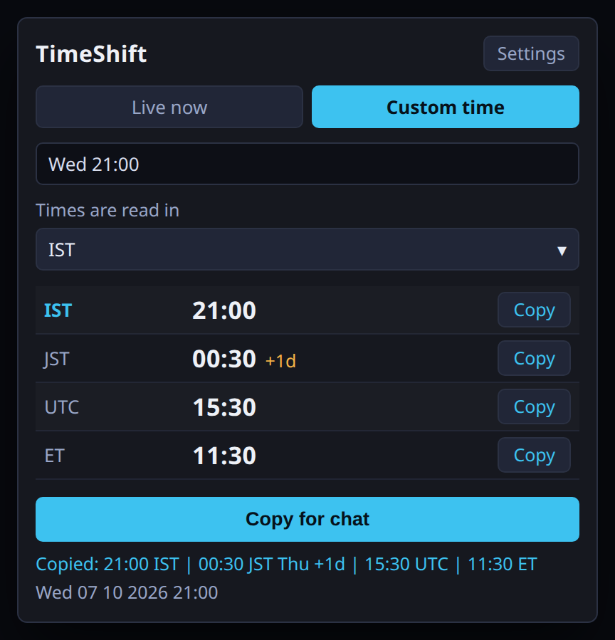
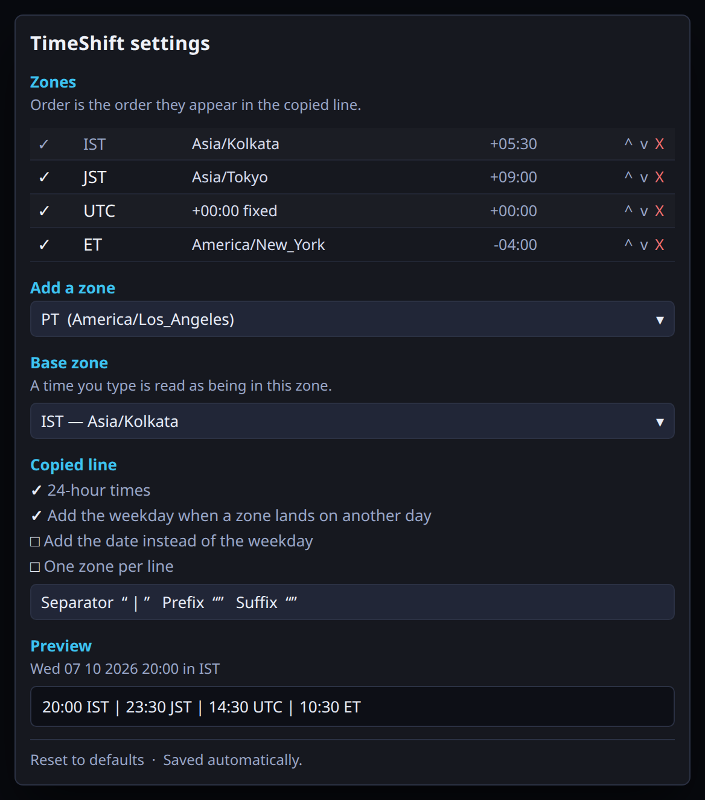

# WorldClock14

Convert a time into every timezone you care about, then paste it into chat.

## Screenshots

Simulated window mockups (same layout and colours as the ImGui UI; times are fixed
examples so the day-rollover marker is visible).

| Live now | Custom time (day rollover) |
|---|---|
|  |  |



Regenerate from the HTML sources with `node scripts/capture-screenshots.mjs`
(needs Chrome/Chromium and Pillow).

## The problem

"Raid at 20:00" is useless to a party spread across IST, JST, UTC and ET — and the
conversion that matters is not the hour, it is the **day**. A time that reads Thursday
in Tokyo reads Wednesday in New York, and that is the mistake that loses people.

## What it does

- **Live now** (default): the current instant in every zone you have configured, always ticking.
- **Custom time**: type a time and see it everywhere.
  `20:00` · `8pm` · `8:30pm` · `2000` · `930` · `20` · `Wed 21:00` · `next mon 09:00` ·
  `tomorrow 20:00` · `2026-10-07 20:00` · `2026-10-07T20:00` · `10/07 20:00`
- **Copy for chat**: one line, `16:30 IST | 20:00 JST | 11:00 UTC | 07:00 ET`, or a per-zone
  Copy on any row. Rolled-over zones get a marker: `22:00 ET Wed -1d`.
- `/tz <time>` converts and copies without opening the window; `/tz` opens it; `/tzconfig`
  opens settings; `/tz now` converts this instant.

## Zones

Defaults are IST, JST, UTC and ET. The list is yours: add from 25 presets, type any IANA
(`Asia/Tokyo`) or Windows (`Tokyo Standard Time`) id, or pin a raw offset as minutes
(`330` = `+05:30`) that never shifts for DST. Reorder, disable, rename.

The base zone — what a typed time is *read as* — defaults to system local and can be any
zone in the list.

## Design notes

- **No hooks, no native pointers, no game memory.** The plugin reads the clock and draws.
  All conversion logic lives in `TimeConversion.cs` with zero Dalamud types in it.
- **DST is handled, not guessed.** A time that does not exist (the spring-forward gap) is
  refused with an explanation instead of silently resolving to the wrong instant; the
  repeated hour in autumn is flagged.
- **Bad zone ids cannot take the window down**: an unresolvable id becomes a row that says
  so, and the base zone falls back to system local.
- **Clipboard writes happen inside a draw frame**, queued from `/tz` rather than written
  from the command callback.

## Layout

| File | |
|---|---|
| `TimeConversion.cs` | all logic — parsing, zone resolution, conversion, chat formatting (no Dalamud) |
| `Defaults.cs` | seeded zones and presets (no Dalamud) |
| `Configuration.cs` | `IPluginConfiguration`, normalization of a hand-edited config |
| `TimeShiftWindow.cs` | main window |
| `ConfigWindow.cs` | settings |
| `UiHelpers.cs` | shared widgets |
| `preview.html` | window mockup, live via `Intl` |
| `screenshots/` | static mockup HTML + PNGs for the README |

## Offline tests

`tests/LogicTests` compiles `TimeConversion.cs` and `Defaults.cs` **from the plugin**
(`<Compile Include>`, no copies) and runs with no Dalamud, no dev distrib and no game:

```
cd tests/LogicTests && dotnet run -c Release
# 148,970 checks, 0 failures
```

That includes a round-trip over 148,860 wall clocks (2024–2027, 17 zones): naive time →
instant → back to the same wall clock, with DST-gap and ambiguous hours skipped by design.

### Reference comparison

ICUs on two different sides, compared row by row — 2024-01-01 → 2027-01-01, hourly, 18 zones:

```
cd tests/LogicTests && dotnet run -c Release -- --dump grid.net.tsv
node ../reference.mjs grid.icu.tsv
python ../compare.py grid.net.tsv grid.icu.tsv
```

473,472 rows compared, 0 mismatches, byte-identical output.

## Build

Needs the .NET 10 SDK and the Dalamud dev distrib at
`%AppData%\XIVLauncher\addon\Hooks\dev` (or `DALAMUD_HOME`).

```
dotnet build -c Debug      # load bin/Debug/WorldClock14.dll as a dev plugin
dotnet build -c Release    # zip in bin/Release/WorldClock14/latest.zip
```

Dev plugin path: `/xlsettings` → Experimental → Dev Plugin Locations.
